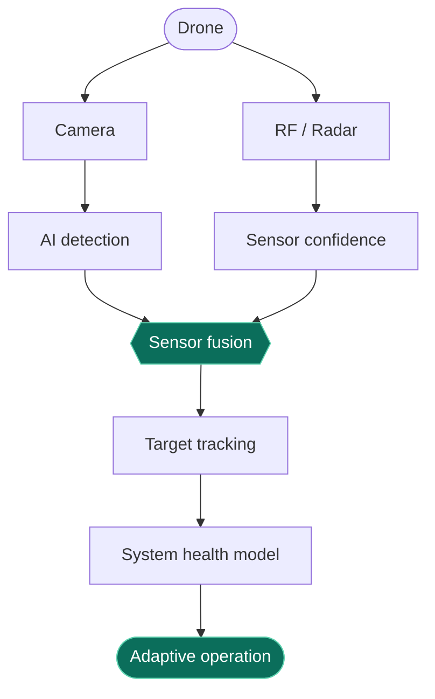

<!-- Animated banner -->

<!-- Typing line -->

  

  
  
  

  
  
  
  

---

<h2 align="center">
  
</h2>

I like projects that have a clear way to fail, then design against it.

- 🛰️ **AEROGUARD** keeps tracking a drone when the camera stops being reliable, by fusing camera, RF and radar.
- 🏆 **MLC x ACS Hackathon site** keeps a live leaderboard correct while organisers edit scores.
- 🛒 **Daam** finds the lowest total price for a product across nine Indian stores.
- 🧩 I sharpen my problem solving on [LeetCode](https://leetcode.com/u/Steadipex/).
- 📱 Always shipping: from first Git exercises to full-stack apps.

> *"Never give up."* 😤

---

<h2 align="center">
  
</h2>

  

<table align="center">
  <tr>
    <td align="center"><b>Languages</b></td>
    <td>Python · Java · C++ · JavaScript · Dart · SQL · HTML · CSS</td>
  </tr>
  <tr>
    <td align="center"><b>Databases</b></td>
    <td>PostgreSQL</td>
  </tr>
  <tr>
    <td align="center"><b>Frameworks</b></td>
    <td>Node.js · Express · Flutter</td>
  </tr>
  <tr>
    <td align="center"><b>Practice</b></td>
    <td>Data structures &amp; algorithms · Sensor fusion · REST APIs · Server-Sent Events · Unit testing</td>
  </tr>
  <tr>
    <td align="center"><b>Tools</b></td>
    <td>Git · GitHub · Android Studio</td>
  </tr>
</table>

---

<h2 align="center">
  
</h2>

  
  

  
  

| Project | What it does | Built with |
| :-- | :-- | :-- |
| 🛰️ [**AEROGUARD**](https://github.com/Steadipex/AEROGUARD) | Environment-adaptive anti-drone detection and tracking. Weights camera, RF and radar by how well each is performing in cold, thin air and vibration. |  |
| 🏆 [**MLC x ACS Hackathon**](https://github.com/Steadipex/MLC-x-ACS-hackathon) | Teams, points and a live leaderboard over Server-Sent Events, with chart data and a key-protected admin panel. No database needed. |    |
| 🛒 [**Daam**](https://github.com/Steadipex/daam) | Price comparison across Amazon, Flipkart, Meesho, Myntra, Ajio, Croma, Reliance Digital, Nykaa and Tata CLiQ, with budget search, alerts and an assistant. |    |
| ⛅ [**Weather App**](https://github.com/Steadipex/weather-app) | A compact weather app in plain HTML, CSS and JavaScript. |    |
| ✅ [**To-Do App**](https://github.com/Steadipex/To-Do-App) | Cross-platform task app started in Flutter. |   |

### How AEROGUARD thinks

---

<h2 align="center">
  
</h2>

  
  

  

  

<h2 align="center">
  
</h2>

  

<!-- Contribution snake (generated by the workflow in .github/workflows/snake.yml) -->

  <picture>
    <source media="(prefers-color-scheme: dark)" srcset="https://raw.githubusercontent.com/Steadipex/Steadipex/output/github-snake-dark.svg" />
    <source media="(prefers-color-scheme: light)" srcset="https://raw.githubusercontent.com/Steadipex/Steadipex/output/github-snake.svg" />
    
  </picture>

---

<h2 align="center">
  
</h2>

  Open to internships, collaborations and hackathon teams. 
  📫 <a href="mailto:adityamondal.cps@gmail.com">adityamondal.cps@gmail.com</a>

